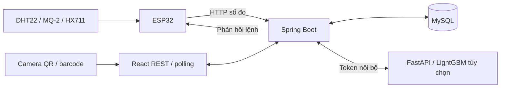

# Kiến trúc hiện tại

Mô tả code đang có, thay cho thiết kế ban đầu dùng RFID/MQTT và cân tổng kệ.

## Thành phần và luồng dữ liệu

ESP32 dùng một sketch. Task HTTP nhận bản sao dữ liệu; setup/loop xử lý HX711 và Preferences.
Web đọc SKU bằng camera, không qua RC522. MQTT/Redis/RabbitMQ/STOMP không phải hạ tầng cần chạy hiện tại.

## Môi trường

Kho 1 nhận số đo thật theo monitoringDeviceCode; Kho 2–4 mô phỏng có nhãn.
Java suy luận RandomForest nhiệt độ/độ ẩm, phân cấp gas ADC bằng ngưỡng riêng, lấy mức cao hơn.
Model đã xuất trong resources Java nên không gọi Python.
Ngưỡng bảo quản sản phẩm là luồng riêng tạo cảnh báo theo kệ/sản phẩm.
Xem [giới hạn AI thử nghiệm](../AI/HYBRID.md).

## Nhập/xuất và cân

- inventory lưu tổng tồn theo sản phẩm; shelf_stock lưu phần tồn đã xếp theo kệ/sản phẩm.
- stock_transaction lưu giao dịch, liên kết bằng chứng cân nếu có.
- Nhập/xuất xử lý theo transaction; xuất không vượt tổng tồn.
- Nhập có thể chọn kệ; xuất trừ kệ có lượng hàng lớn trước.
- Gợi ý kệ chấm điểm bằng quy tắc Java, không dùng model dự báo.
- HX711 cân từng dòng phiếu: số lượng × trọng lượng đơn vị (gram), không suy ra số lượng.
- scale_ticket chỉ dùng một lần, đúng người/SKU/số lượng/loại phiếu, hết hạn 10 phút.
- Số đo/lệnh cân giữ trong RAM: một thiết bị cấu hình, một backend instance.
- scale_settings và scale_ticket nằm trong DB; hệ số cân lưu ở Preferences của ESP32.

## Dự báo

Spring tổng hợp lịch sử OUT theo ngày/kho/sản phẩm từ stock_transaction, phân biệt nguồn
REAL và SIMULATED. V13 khởi tạo lịch sử seed một lần. Train 05:00 thứ Hai giờ Việt Nam,
dự báo hằng ngày dùng lại model, có chạy bù và job lưu bền vững.
Local dùng một Uvicorn worker, joblib trên volume; cloud dùng GitHub Actions chạy batch,
joblib và kết quả lưu MySQL bằng V15. Xem [hợp đồng](demand-forecasting.md) và
[hướng dẫn cloud](cloud-render.md).

## Giao diện và quyền

Login không chọn vai trò: JWT quyết định trang đích, ưu tiên admin → manager → staff.
Sidebar ba vai trò 248 px, thu gọn 86 px; thương hiệu SMART / WAREHOUSE hai dòng.
Admin/manager được hiệu chuẩn và chỉnh sai số; staff được xem cân, trừ bì, lấy cân vào phiếu.
Dự báo dành cho admin/manager. Backend kiểm tra quyền độc lập với giao diện.

## Triển khai

Local: web 5173, backend 8080, MySQL 3306, Python tùy chọn 8091 trên loopback.
Docker: Nginx xuất 8088; /backend/ chuyển sang backend:8080.
MySQL và ML chỉ ở mạng Compose; mysql_data và ml_data giữ dữ liệu.
Schema mới: B1 rồi V2–V15; xem [README](../README.md).

Chưa có triển khai cloud được xác nhận. Đưa ứng dụng, database và phân tích lên cloud
với một ESP32 là mục tiêu cấp 3 theo thang đã thảo luận. Cấp 4 cần nhiều nút có phân tích cục bộ
và cơ chế quan sát/nhận cập nhật phù hợp; bốn kho trên dashboard không phải bốn nút thật.
Trước public cần HTTPS, xác minh chứng chỉ ESP32, cấu hình origin web và khóa riêng.
Render có blueprint render.yaml cho frontend static/backend Free; Aiven MySQL tạo riêng,
Python batch trên GitHub Actions. Compose vẫn dùng cho local. Các cấu hình đã được chuẩn bị,
chưa xác nhận triển khai cloud hay thiết bị thật; xem [biên bản nghiệm thu](cloud-acceptance.md).
