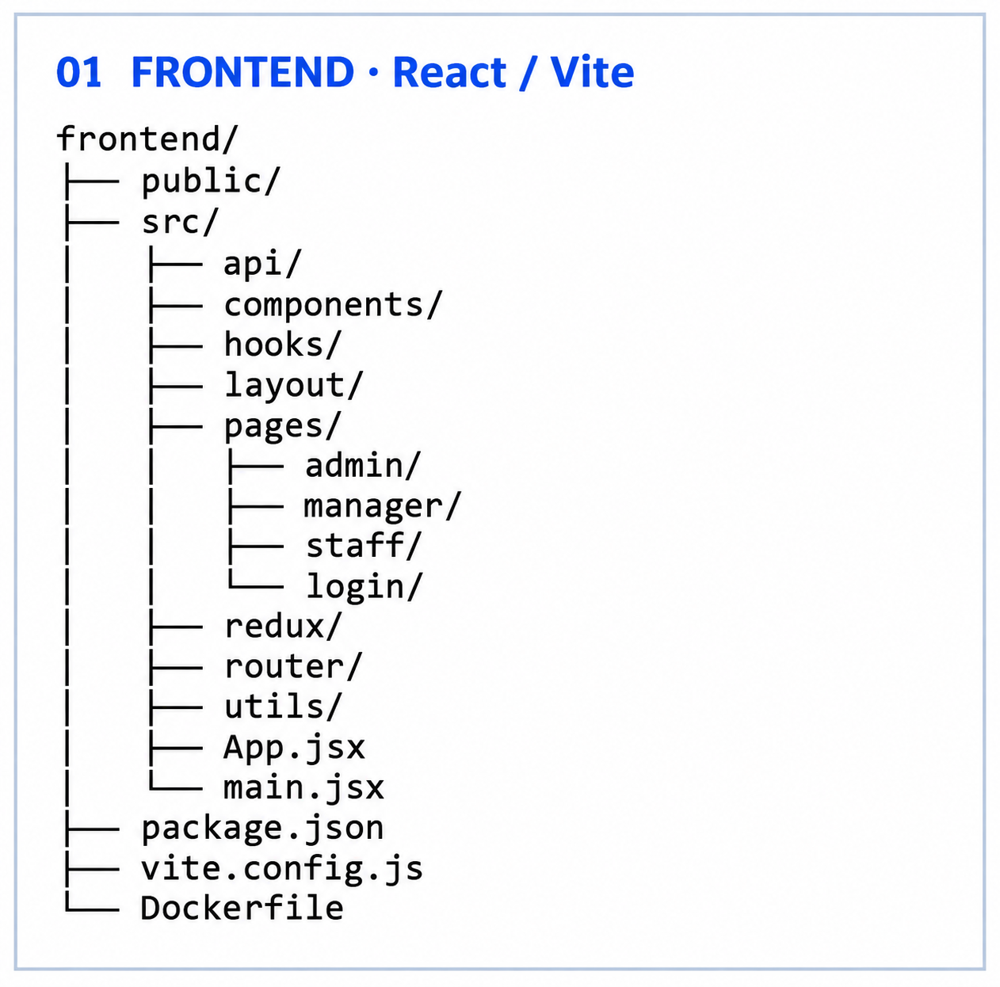
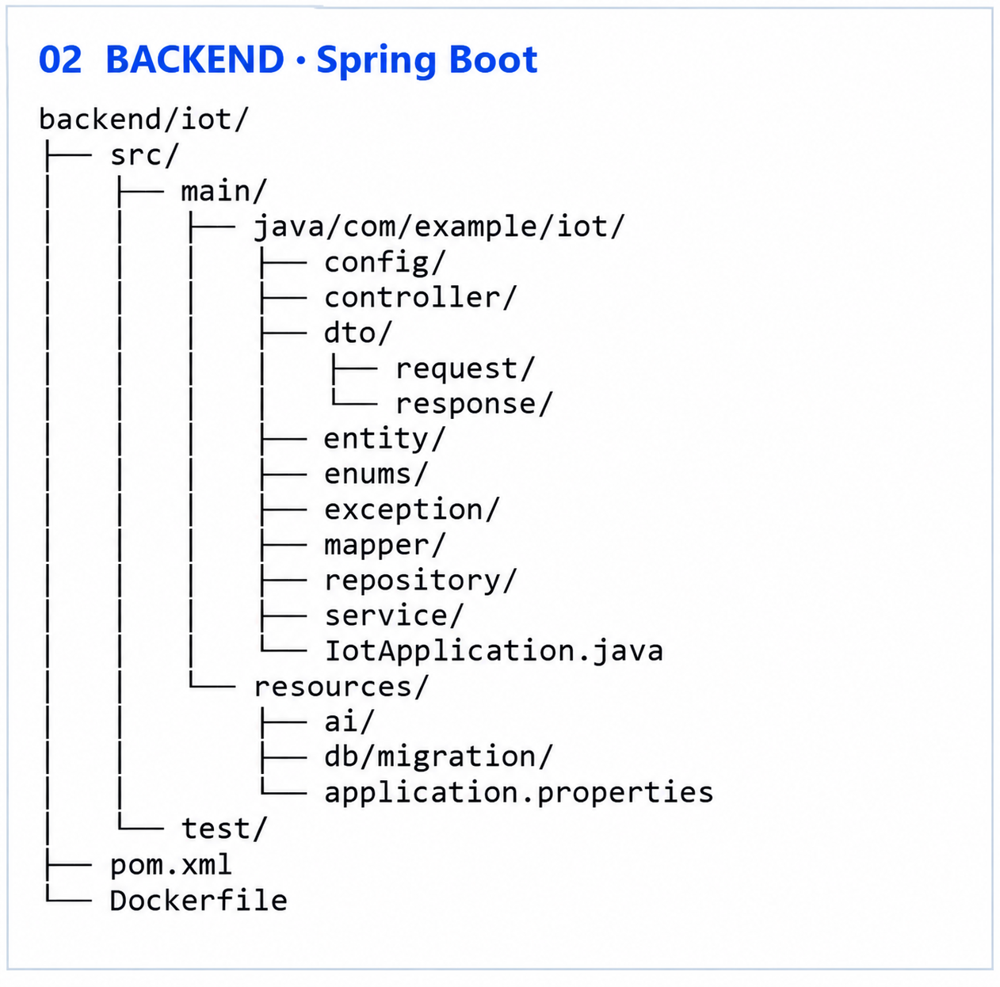
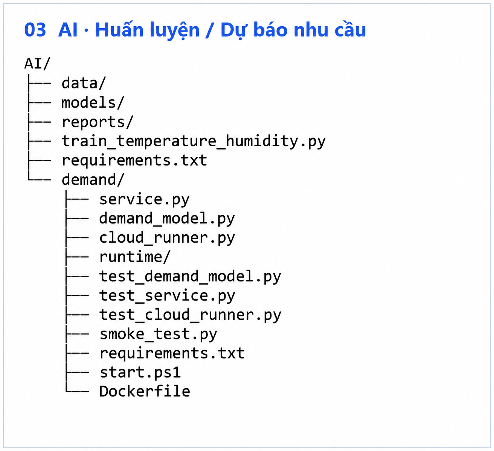
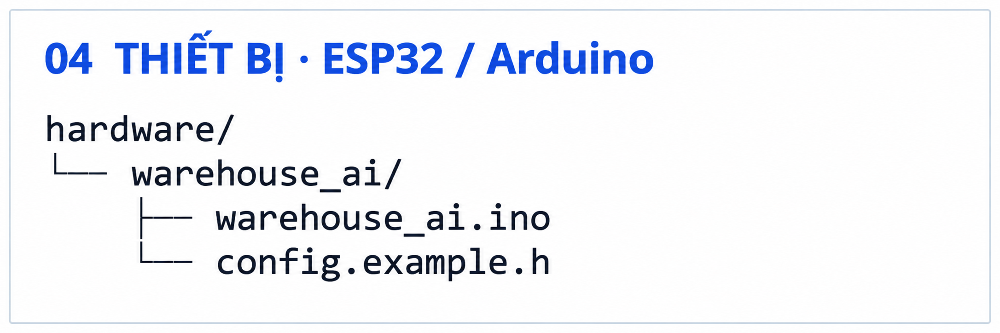

# Cấu trúc dự án

Mã nguồn Smart Warehouse được tổ chức trong một kho mã nguồn chung, phân chia theo chức năng của từng thành phần: giao diện người dùng, backend, xử lý AI và chương trình điều khiển ESP32. Mỗi thành phần có thư mục mã nguồn và cấu hình riêng, thuận tiện cho việc phát triển, kiểm thử và triển khai. Các thành phần trao đổi dữ liệu thông qua API do backend cung cấp.

## 1. Cấu trúc tổng thể

| Thư mục hoặc tệp | Vai trò |
| --- | --- |
| `frontend/` | Mã nguồn giao diện web sử dụng React và Vite. |
| `backend/iot/` | Ứng dụng Java Spring Boot, cung cấp API và xử lý nghiệp vụ quản lý kho. |
| `AI/` | Chương trình huấn luyện, xuất mô hình môi trường và dịch vụ dự báo nhu cầu. |
| `hardware/warehouse_ai/` | Chương trình điều khiển ESP32 và cấu hình kết nối thiết bị. |
| `database/seeds/` | Dữ liệu SQL mẫu và hướng dẫn nạp dữ liệu. |
| `docs/` | Tài liệu kiến trúc, các phân hệ, triển khai và báo cáo dự án. |
| `scripts/` | Công cụ hỗ trợ chuyển đổi dữ liệu và kiểm tra một số luồng xử lý. |
| `postman/` | Tài nguyên phục vụ kiểm tra API bằng Postman. |
| `.github/workflows/` | Cấu hình các quy trình tự động, bao gồm xử lý dự báo theo chế độ cloud batch. |
| `compose.yaml`, `compose.https.yaml` | Cấu hình phối hợp các dịch vụ bằng Docker Compose và cấu hình bổ sung cho HTTPS. |
| `render.yaml` | Cấu hình triển khai ứng dụng trên Render. |

## 2. Thành phần frontend

*Hình 1. Cấu trúc thư mục frontend.*

Thư mục `frontend/` chứa ứng dụng React, sử dụng Ant Design để xây dựng giao diện và Redux Toolkit để quản lý trạng thái dùng chung. Phần lớn mã nguồn nằm trong `frontend/src/`, được chia theo trách nhiệm:

| Thư mục hoặc tệp | Vai trò |
| --- | --- |
| `src/pages/` | Chứa các trang chức năng, phân thành `admin/`, `manager/`, `staff/` và `login/`. Các trang phục vụ quản lý người dùng, sản phẩm, kho, nhập xuất, giám sát và cân hàng theo từng vai trò. |
| `src/components/` | Chứa các thành phần giao diện tái sử dụng như dashboard IoT, bảng dự báo nhu cầu, camera quét mã, tem QR và hiển thị cân trực tiếp. |
| `src/layout/` | Xây dựng bố cục trang, thanh điều hướng và vùng hiển thị nội dung cho từng nhóm người dùng. |
| `src/router/` | Khai báo tuyến điều hướng và kiểm tra vai trò khi truy cập trang thông qua `RequireRole.jsx`. |
| `src/api/` | Tập trung các hàm gọi API, chia theo nghiệp vụ như sản phẩm, kho, tồn kho, cảm biến, cân và dự báo. |
| `src/redux/` | Khai báo Redux store và trạng thái người dùng. |
| `src/hooks/`, `src/utils/` | Chứa hook theo dõi trạng thái cân và các hàm tiện ích về xác thực, ngày giờ, hiển thị dữ liệu, cảm biến và cân. |
| `src/main.jsx`, `src/App.jsx` | Điểm khởi tạo và thành phần gốc của ứng dụng. |
| `public/` | Chứa tài nguyên tĩnh như biểu tượng và favicon. |

Các tệp `package.json` và `vite.config.js` quản lý thư viện, lệnh chạy và cấu hình Vite. `Dockerfile` cùng các tệp cấu hình Nginx phục vụ đóng gói và cung cấp giao diện khi triển khai.

## 3. Thành phần backend

*Hình 2. Cấu trúc thư mục backend.*

Backend nằm tại `backend/iot/`, được xây dựng bằng Java và Spring Boot. Mã nguồn chính trong `src/main/java/com/example/iot/` được tổ chức theo các lớp trách nhiệm:

| Thư mục | Vai trò |
| --- | --- |
| `controller/` | Tiếp nhận yêu cầu HTTP và cung cấp API cho giao diện, ESP32 và luồng dự báo. |
| `service/` | Xử lý nghiệp vụ như nhập xuất, quản lý tồn kho, phân bổ kệ, giám sát môi trường, cân đối chiếu và điều phối tác vụ dự báo. |
| `repository/` | Truy cập cơ sở dữ liệu thông qua Spring Data JPA. |
| `entity/` | Khai báo các thực thể ánh xạ với bảng dữ liệu, chẳng hạn người dùng, sản phẩm, kho, tồn kho, giao dịch và phiếu cân. |
| `dto/request/`, `dto/response/` | Định nghĩa dữ liệu đầu vào và đầu ra của các API. |
| `mapper/` | Chuyển đổi dữ liệu giữa đối tượng nghiệp vụ và DTO ở các chức năng có sử dụng mapper. |
| `config/` | Cấu hình bảo mật, JWT, CORS, khởi tạo dữ liệu và giám sát môi trường. |
| `enums/`, `exception/` | Khai báo các kiểu liệt kê và các lớp ngoại lệ phục vụ xử lý lỗi. |

Luồng xử lý thông thường đi từ `controller` đến `service`, sau đó sử dụng `repository` để đọc hoặc ghi dữ liệu. Cách phân lớp này tách việc tiếp nhận yêu cầu khỏi logic nghiệp vụ và thao tác lưu trữ.

Thư mục `src/main/resources/` chứa cấu hình ứng dụng trong `application.properties`, cấu hình cloud trong `application-cloud.properties`, các bản cập nhật cấu trúc cơ sở dữ liệu tại `db/migration/` và mô hình AI đã xuất tại `ai/`. Thư mục `src/test/` chứa mã và dữ liệu kiểm thử. Tệp `pom.xml` quản lý thư viện và cấu hình Maven; `IotApplication.java` là điểm khởi động backend.

## 4. Thành phần AI

*Hình 3. Cấu trúc thư mục AI và dịch vụ dự báo nhu cầu.*

Thư mục `AI/` gồm hai nhóm chức năng: xây dựng mô hình cảnh báo môi trường và dự báo nhu cầu xuất kho.

Đối với **mô hình môi trường**, `train_temperature_humidity.py` thực hiện huấn luyện mô hình từ nhiệt độ và độ ẩm, đồng thời xuất mô hình sang định dạng để backend Java sử dụng. Các thư mục chính gồm:

| Thư mục | Vai trò |
| --- | --- |
| `AI/data/` | Lưu dữ liệu phục vụ quá trình xây dựng và đánh giá mô hình môi trường. |
| `AI/models/` | Lưu mô hình đã huấn luyện dưới dạng tệp `joblib`. |
| `AI/reports/` | Lưu chỉ số đánh giá và báo cáo phân loại. |

Mô hình môi trường được xuất sang `backend/iot/src/main/resources/ai/` để suy luận trực tiếp trong Java. Mức gas từ MQ-2 được xử lý bằng ngưỡng riêng rồi kết hợp với kết quả mô hình. Các chương trình huấn luyện và xuất mô hình khác như `train_mq2.py`, `export_mq2.py`, `export_model.py`, `forest_export.py` cùng tài liệu `MQ2.md` được giữ để nghiên cứu, đối chiếu với các luồng cũ.

Đối với **dự báo nhu cầu**, thư mục `AI/demand/` chứa dịch vụ Python độc lập:

| Thư mục hoặc tệp | Vai trò |
| --- | --- |
| `service.py` | Cung cấp API bằng FastAPI, nhận dữ liệu lịch sử và tác vụ huấn luyện hoặc dự báo từ backend. |
| `demand_model.py` | Xử lý dữ liệu, huấn luyện, đánh giá và suy luận mô hình LightGBM để dự báo lượng xuất trong 14 ngày. |
| `cloud_runner.py` | Thực hiện tác vụ dự báo theo chế độ cloud batch, phối hợp với backend. |
| `runtime/` | Mặc định lưu dữ liệu và kết quả phát sinh khi chạy dịch vụ cục bộ: mô hình, trạng thái tác vụ, chỉ số và kết quả dự báo. Vị trí lưu có thể thay đổi qua cấu hình. |
| `test_*.py`, `smoke_test.py` | Kiểm tra mô hình, dịch vụ, luồng cloud và khả năng tái sử dụng mô hình. |
| `requirements.txt`, `start.ps1`, `Dockerfile` | Khai báo thư viện Python, hỗ trợ khởi chạy và đóng gói dịch vụ. |

Backend tổng hợp lịch sử giao dịch và điều phối tác vụ; dịch vụ Python thực hiện tính toán dự báo. Nhánh này hoạt động độc lập với mô hình cảnh báo môi trường chạy trong Java.

## 5. Chương trình điều khiển ESP32

*Hình 4. Cấu trúc thư mục chương trình ESP32.*

Thư mục `hardware/warehouse_ai/` chứa chương trình Arduino dành cho ESP32. Các chức năng điều khiển được tích hợp trong một sketch chính:

| Tệp | Vai trò |
| --- | --- |
| `warehouse_ai.ino` | Khởi tạo thiết bị; đọc DHT22, MQ-2 và HX711; xử lý cân, trừ bì và hiệu chuẩn; gửi số đo đến backend; nhận phản hồi và điều khiển đèn, quạt, còi. |
| `config.example.h` | Cấu hình mẫu cho Wi-Fi, địa chỉ backend, khóa thiết bị, mã thiết bị và chứng chỉ HTTPS. |
| `config.local.h` | Tệp cấu hình riêng được tạo khi thiết lập thiết bị. Firmware ưu tiên đọc tệp này nếu tồn tại; tệp được loại khỏi Git. |

Trong `warehouse_ai.ino`, hàm `setup()` khởi tạo phần cứng, kết nối và các tác vụ; `loop()` thực hiện việc thu thập dữ liệu và xử lý cân. Các tác vụ mạng riêng gửi số đo môi trường và cân đến backend để hạn chế ảnh hưởng của thời gian chờ HTTP đến việc lấy mẫu HX711. Thông tin hiệu chuẩn được lưu bằng `Preferences` trên ESP32.

*Phạm vi trình bày tập trung vào cách tổ chức mã nguồn và vai trò các thư mục, tệp quan trọng; không liệt kê toàn bộ tệp hoặc nội dung chương trình.*
